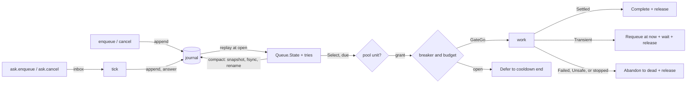

# runner

A durable job runner (an outbox). It keeps a scheduler queue in a journal, bounds the attempts that run at once with a resources pool, and retries failed jobs with retry's policy and a breaker per target.

```bend
import bend-kit-runner@0.8.1.0/runner.bend as R
```

It imports `bend-kit-journal@0.2.0.0`, `bend-kit-scheduler@0.3.0.0`, `bend-kit-resources@0.1.0.0`, `bend-kit-retry@0.2.0.0`, `bend-kit-time@0.2.0.0`, `bend-kit-collections@0.1.3.0`, `bend-kit-files@0.2.0.0`, and `bend-kit-bytes@0.3.2.0`. Payload codecs take and give that version's `Bytes`. Policies, budgets, and outcomes are `bend-kit-retry@0.2.0.0` types; tickets are `bend-kit-scheduler@0.3.0.0` types.



## Example

A job is a `String`. `work` prints it and succeeds. The journal file keeps the jobs across restarts: a job that a crash interrupted runs again at the next `open`.

```bend
import Base
import bend-kit-bytes@0.3.2.0/bytes.bend as Bytes
import bend-kit-retry@0.2.0.0/retry.bend as Retry
import bend-kit-runner@0.8.1.0/runner.bend as R

def penc(s: String) -> Bytes.Bytes:
  Bytes.from_string(s)

def pdec(b: Bytes.Bytes) -> Maybe<&2, String>:
  Some{Bytes.to_string(b)}

def target(s: String) -> String:
  "printer"

def work(s: String) -> IO(Retry.Outcome):
  do IO<Retry.Outcome>:
    IO.print("job: " ++ s)
    return Retry.Settled{}

# 3 attempts, 100 ms first backoff, 5 s cap. 5 failures in 60 s open the breaker for 30 s.
# Compact the journal after each 1 MiB of records.
def config() -> R.Config:
  R.Config{Retry.Policy{3n, 100n, 5000, None{}}, Retry.Circuit{5n, 60000n, 30000n, 1n}, 50, 1048576}

def added(y: R.Runner<String> & R.Out(Nat)) -> IO(R.Runner<String>):
  match y:
    case (r, Done{id}):
      IO.pure(R.Runner<String>, r)
    case (r, Fail{(c, m)}):
      IO.die(R.Runner<String>, 1, m)

def done(y: R.Ran(String)) -> IO(Unit):
  match y:
    case (r, Done{u}):
      R.close(String, r)
    case (r, Fail{(c, m)}):
      IO.die(Unit, 1, m)

def main() -> IO(Unit):
  do IO<Unit>:
    r0 : R.Runner<String> <- IO.try(R.Runner<String>, R.open(~String, ~penc, ~pdec, "jobs.journal", 4096, 16777216, config(), 4n))
    r1 : R.Runner<String> & R.Out(Nat) <- R.enqueue(~String, ~penc, r0, 0n, "send the report")
    r2 : R.Runner<String> <- added(r1)
    y : R.Ran(String) <- R.drain(~String, ~penc, ~target, ~work, 1000n, r2)
    done(y)
```

[example.bend](example.bend) is a full webhook outbox: each job signs a Standard Webhooks POST with `bend-kit-webhooks` and sends it through `bend-kit-hairpin`. Its receiver answers 503 once, and the runner requeues that delivery and completes it on the next attempt.

## API

`~penc: A -> Bytes.Bytes` and `~pdec: Bytes.Bytes -> Maybe<&2, A>` encode the payload. `pdec(penc(x))` must be `Some{x}`: the replay laws assume it. `~target: A -> String` names a job's breaker. `~work: A -> IO(Retry.Outcome)` runs one attempt.

| def | does |
|---|---|
| `open(~A, ~penc, ~pdec, path, max, limit, config, capacity)` | Opens or creates the journal at `path` and replays it: from its snapshot, when it has one, then each op after it. Each ticket that was running is requeued at now as a failed attempt. `capacity` bounds the attempts that run at once. |
| `enqueue(~A, ~penc, r, deadline, x)` | Adds a job due at `deadline` (wall-clock ms since the Unix epoch). Answers its ticket id once the record is durable. |
| `cancel(~A, ~penc, r, id)` | Cancels a ticket. An attempt that runs finishes, but the ticket is never selected again. A dead ticket is dropped. |
| `revive(~A, ~penc, r, id, deadline)` | Makes dead ticket `id` pending again at `deadline`, with its payload and a new retry budget. A ticket that is not dead does not change. |
| `tick(~A, ~penc, ~target, ~work, r)` | One round: start an attempt for each due ticket that the pool admits, then read the inbox. As each attempt finishes, record its outcome, give back its unit, and start the next due ticket in that unit. Append and answer each ask. The round ends when no attempt runs and the inbox is empty, or when its fuel ends; attempts that still run stay in the runner for the next `tick`. Then compact when the journal grew past `compact`. `Done{True}` when an attempt ran or an ask was answered. |
| `drain(~A, ~penc, ~target, ~work, fuel, r)` | Ticks until no ticket is pending or running and no attempt runs, waiting `idle` ms after a round that did nothing. Fails after `fuel` rounds with work left. |
| `inbox(A, r)` | The runner and its inbox, a `Chan(Msg<A>)`. Pass the inbox to another fiber. |
| `ask.enqueue(A, inbox, deadline, x)` | From another fiber: `enqueue`, answered with the ticket id once the record is durable. |
| `ask.cancel(A, inbox, id)` | From another fiber: `cancel`. A running attempt finishes, and its outcome does not requeue the ticket. |
| `compact(~A, ~penc, r)` | Replaces the journal with one snapshot record of the state. See [Compaction](#compaction). |
| `state(A, r)` | The runner and a copy of its `State`. `dead(A, s)` lists the dead tickets of a `State`, newest first, each a `Dead{ticket, why}` with its payload. |
| `close(A, r)` | Closes the inbox and the journal. Each ask still in the inbox fails with `runner: the runner closed`, and no op is appended for it. |

`Config{policy, circuit, idle, compact}`: retry's `Policy` for every ticket, the `Circuit` of each target's breaker, `drain`'s wait, and the octets of records that `tick` lets the journal grow by, since open or the last compaction, before it compacts. A `compact` of 0 turns automatic compaction off. `max` caps one op record's octets and `limit` caps the journal file and a snapshot, as in `journal`. A failed append stops the runner: every later call fails until it is reopened.

### Records

Every transition is one journal record, appended and fsynced before the state changes:

| op | appended when | state change |
|---|---|---|
| `Enqueue{deadline, x}` | `enqueue` | `Queue.enqueue`, and a `Try{0, deadline}` under the new id |
| `Select{now}` | a due ticket and a free pool unit | `Queue.select(now)`. Replay runs it at the same `now`, so it takes the same ticket. |
| `Complete{id}` | the attempt settled | `Queue.complete(id)`, which takes the ticket from the running list, and the `Try` is dropped |
| `Cancel{id}` | `cancel` | `Queue.cancel(id)`, which takes the ticket from both registries; the dead ticket `id` is dropped, and so is the `Try` |
| `Requeue{id, d}` | the attempt failed, or a crash interrupted it | `Queue.requeue(id, d)`, one more failure in the `Try` |
| `Defer{id, d}` | the target's breaker is open | `Queue.requeue(id, d)`, no failure counted |
| `Abandon{id, why}` | retry gave up: the budget is spent (`WhySpent`), the deadline passed (`WhyLate`), the failure was `Unsafe` (`WhyUnsafe`), or the failure was `Failed`, which another try would repeat (`WhyFailed`) | `Queue.complete(id)`, and the ticket, with its payload, goes to the dead tickets; the `Try` is dropped |
| `Revive{id, d}` | `revive` | the dead ticket `id` goes back to the pending heap at `d`, with a `Try{0, d}` |

The record is a u32le tag (1 to 6, 8, or 9), then u64le fields, then the payload for `Enqueue`. An `Abandon`'s second field is its why: 0 spent, 1 late, 2 unsafe, 3 failed. A ticket's budget is the policy's attempts less its failures, and its deadline is the policy deadline after its first due time. `Select` is journaled so that the replayed queue equals the live one, running list included. A dead ticket is neither pending nor running, so `drain` does not wait for it.

### Compaction

Completed jobs keep their records, so a journal grows with its history. `compact` writes the live state, the queue, the tries, and the dead tickets, as one `Snap` record into `path.compact`, fsyncs it, renames it over `path`, and reopens `path`, which fsyncs the directory. `open` replays the snapshot, then the ops after it.

A crash leaves either the old journal or the new one, and both replay to the same state. A leftover `path.compact` is removed by the next compaction. When compaction fails before the rename, the old journal stands and the runner goes on. When it fails after the rename, appends stop until the runner is reopened.

A `Snap` record is tag 7 and the next id, then the pending heap, the running list, the tries, and the dead tickets, node by node, so the replayed trees have the live shape. Each node or cell starts with a u32 flag of 1, and each end is a flag of 0. A ticket is its u64 id and deadline, then a u32 length and the payload; a dead ticket then has a u32 why. The snapshot is one record, so it must fit `limit`, not `max`.

## Laws

`LAWS.bend` states them and `PROOF.bend` proves them over the runner's own `step`, `apply`, `load`, `pick`, and `after`. `open` folds `load`, which steps an op record as `apply` does.

| law | claim |
|---|---|
| `replay_live` | When every record decodes to its op, replaying the records of any ops gives the state that applying them live gives. |
| `replay_prefix` | The same for the first `k` ops: the committed prefix that recovery keeps after a crash. |
| `replay_snapshot` | When every record decodes to itself, replaying a snapshot of `live(ops, s)` and then the records of `more` gives `live(more, live(ops, s))`, from any start state. |
| `complete_never_selected` | After `Complete{i}` and any ops, no `Select` takes ticket `i`. It assumes `i` was issued and was neither pending nor dead, as a running ticket is. |
| `cancel_never_selected` | After `Cancel{i}` and any ops, no `Select` takes ticket `i`, when `i` was issued. |
| `recovered_never_selected` | The `Complete` claim for the state that `open` replays from the journal. |
| `dead_never_selected` | After `Abandon{i, why}` and any ops with no `Revive` of `i`, no `Select` takes ticket `i`. It assumes `i` was issued and was not pending. |
| `pick_holds_one` | A picked attempt holds exactly one more pool unit; an idle pick holds none. |
| `pick_bounded` | The units held after a pick never exceed the capacity. |
| `pick_release` | Releasing a picked grant once gives back the pool as it was before the pick. |
| `requeue_wait` | When `retry.plan` waits `w`, the record is `Requeue{id, now + w}`. |
| `settled_complete` | A `Settled` attempt gives `Complete{id}`. |
| `unsafe_abandon` | An `Unsafe` attempt gives `Abandon{id, WhyUnsafe}`. |
| `failed_abandon` | A `Failed` attempt gives `Abandon{id, WhyFailed}`, so the ticket is dead after one attempt. |
| `transient_abandon` | When `retry.plan` stops a `Transient` failure, the record is `Abandon{id, gave(b)}`: `WhySpent` when no attempt is left, else `WhyLate`. |

`journal`'s `replay` and `roundtrip` laws give the other half of `replay_prefix`: `open` folds exactly the committed records, in order. `scheduler`'s laws give the queue's own behavior, such as `requeue_token`.

## Trust boundary

- **Journal.** Durability is the journal's: a record is on disk when `append` answers `Done`, under the trust assumptions in [journal/README.md](../journal/README.md#trust-boundary).
- **At least once.** A crash after `Select` and before `Complete` reruns the job at the next `open`. A crash after the job's effect and before `Complete` repeats the effect. Make jobs idempotent, as webhook receivers do with the event id.
- **Codec.** The laws assume `pdec(penc(x)) == Some{x}` and that the op and snapshot codecs round-trip. `check.bend` tests the op codec on every op, including 41-bit deadlines, and the snapshot codec on a state with pending, running, retried, and dead tickets. A record that does not decode fails `open` with `EINVAL` (22). Nat fields must stay under 2^64.
- **Wiring.** The laws cover the pure transitions. `open`, `tick`, and `drain` are IO that appends each op before it applies it, and gives each grant back after its attempt. `check.bend` tests that wiring, not a proof.
- **Clock.** Deadlines are wall-clock ms, so they keep their meaning across restarts. A clock that jumps moves every due time with it.
- **Breakers.** Breaker state lives in memory. A restart closes every breaker.
- **One writer.** Nothing locks the journal. The fiber that holds the runner appends every op: other fibers send asks on the inbox, and `tick` appends each one before it changes the state. `tick` records each outcome as its attempt finishes, so a slow job holds only its own unit. A round takes at most one ticket for each ticket that was pending at its start or that an ask added.
- **Asks.** An ask waits until the owner reads the inbox in `tick` or `drain`. `drain` reads it while an attempt runs; after a round that did nothing it sleeps `idle` ms first.
- **Memory.** `open` reads the whole journal. Compaction bounds it by the live state plus the records since the last compaction; with `compact` at 0 and no `compact` call, the journal grows without bound.
- **Rename.** Compaction relies on `rename` replacing the journal atomically, as POSIX gives within one directory.

## Checks

`bend check.bend` runs these on the JS lane:

- the op codec round-trips each op, and rejects short records and unknown tags;
- the snapshot codec rebuilds the same state, and rejects a short snapshot, octets after it, and a bad flag;
- three jobs drain: two run once; one fails every time and is dead after the policy's 3 attempts, with its payload. Reopening replays the same state. A revive runs it 3 attempts more, and a cancel drops it;
- a job that answers `Failed` is dead after one attempt, with its payload and `WhyFailed`;
- a child process (`crash.bend`) completes job x, then dies inside job y's attempt. Reopening requeues y as a failed attempt, y runs again, and x does not;
- two failing jobs open their target's breaker at the first failure; no third attempt starts, and the held jobs wait for the cooldown;
- with capacity 2, one tick runs a slow job and five fast jobs: the fast jobs finish in the free unit while the slow one runs, and no more than 2 attempts run at once;
- while a 1 s job runs, another fiber's `ask.enqueue` answers its id before the job ends, and the new job runs in the same drain;
- another fiber's `ask.cancel` of a failing job while its attempt runs leaves the ticket cancelled after the attempt ends, and across a reopen;
- an `ask.enqueue` in the inbox when the owner calls `close` fails at once, and a reopen finds no ticket for it;
- `compact` shrinks a drained journal to a snapshot larger than `max`, and reopening it with later records gives the same state; with `compact` at 1, each tick leaves one snapshot frame;
- a child completes x, writes and fsyncs the snapshot, and dies before the rename. Reopening gives the snapshot's state, a later compaction replaces the stale file, and x does not run again;
- a child completes x, compacts, then dies inside z's attempt. Reopening replays the snapshot and z's records, z runs again, and x does not;
- the webhook example delivers two signed events through a 503.

`bench/` times replay at `open`, before and after compaction. See [bench/README.md](bench/README.md).
