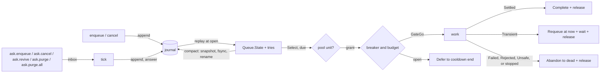

# runner

A durable job runner (an outbox). It keeps a scheduler queue in a journal, bounds the attempts that run at once with a resources pool, and retries failed jobs with retry's policy and a breaker per target.

```bend
import bend-kit-runner@0.22.0.9/runner.bend as R
```

It imports `bend-kit-journal@0.4.0.2/journal.bend` for runtime IO and `bend-kit-journal@0.4.0.2/pure.bend` for read-only inspection and replay benchmarks, `bend-kit-scheduler@0.4.4.0`, `bend-kit-resources@0.1.0.0`, `bend-kit-retry@0.3.0.0`, `bend-kit-time@0.3.0.5`, `bend-kit-collections@0.1.6.0`, `bend-kit-files@0.4.0.3`, `bend-kit-encoding@0.5.0.3`, and `bend-kit-bytes@0.3.3.3`. Payload codecs take and give that version's `Bytes`. Policies, budgets, and outcomes are `bend-kit-retry@0.3.0.0` types; tickets are `bend-kit-scheduler@0.4.4.0` types.



## Example

A job is a `String`. `work` prints it and succeeds. The journal file keeps the jobs across restarts: a job that a crash interrupted runs again at the next `open`.

```bend
import Base
import bend-kit-bytes@0.3.3.3/bytes.bend as Bytes
import bend-kit-retry@0.3.0.0/retry.bend as Retry
import bend-kit-runner@0.22.0.9/runner.bend as R

def penc(s: String) -> Bytes.Bytes:
  Bytes.from_string(s)

def pdec(b: Bytes.Bytes) -> Maybe<&2, String>:
  Some{Bytes.to_string(b)}

def target(s: String) -> String:
  "printer"

def work(s: String) -> IO(Retry.Outcome):
  do IO<Retry.Outcome>:
    IO.print("job: " ++ s)
    return Retry.Settled{}

# 3 attempts, 100 ms first backoff, 5 s cap. 5 failures in 60 s open the breaker for 30 s.
# Compact the journal after each 1 MiB of records.
def config() -> R.Config:
  R.Config{Retry.Policy{3n, 100n, 5000, None{}}, Retry.Circuit{5n, 60000n, 30000n, 1n}, 50, 1048576}

def added(y: R.Runner<String> & R.Out(Nat)) -> IO(R.Runner<String>):
  match y:
    case (r, Done{id}):
      IO.pure(R.Runner<String>, r)
    case (r, Fail{(c, m)}):
      IO.die(R.Runner<String>, 1, m)

def done(y: R.Ran(String)) -> IO(Unit):
  match y:
    case (r, Done{u}):
      R.close(String, r)
    case (r, Fail{(c, m)}):
      IO.die(Unit, 1, m)

def main() -> IO(Unit):
  do IO<Unit>:
    r0 : R.Runner<String> <- IO.try(R.Runner<String>, R.open(~String, ~penc, ~pdec, "jobs.journal", 4096, 16777216, config(), 4n))
    r1 : R.Runner<String> & R.Out(Nat) <- R.enqueue(~String, ~penc, r0, 0n, "send the report")
    r2 : R.Runner<String> <- added(r1)
    y : R.Ran(String) <- R.drain(~String, ~penc, ~target, ~work, 1000n, r2)
    done(y)
```

[example.bend](example.bend) is a full webhook outbox: each job signs a Standard Webhooks POST with `bend-kit-webhooks@0.17.0.3` and sends it through `bend-kit-hairpin@0.19.0.3`. It uses HTTP 0.45.0.3 models from `pure.bend` and effects from `http.bend`. Its receiver reads pure Time 0.3.0.5 with `Http.clock.now()`, answers 503 once, and the runner requeues that delivery and completes it on the next attempt.

## API

`runner.bend` keeps the runtime entry points. Import `bend-kit-runner@0.22.0.9/model.bend` for pure types and operations, including `State`, `Op`, `step`, `pick`, and the record codecs. These names no longer live in `runner.bend`. The runtime uses the same model implementation as the proofs.

`Breakers()` is a `collections.HMap<String, Retry.State>`. The breaker proofs use its checked lookup, insert, and delete laws. The hash folds code points with FNV-1a; equal hashes still compare full target strings.

`~penc: A -> Bytes.Bytes` and `~pdec: Bytes.Bytes -> Maybe<&2, A>` encode the payload. `pdec(penc(x))` must be `Some{x}`: the replay laws assume it. `~target: A -> String` names a job's breaker. `~work: A -> IO(Retry.Outcome)` runs one attempt. Answer `Retry.Rejected` for a client error, such as a 404: the job is dead, and the target's breaker does not count it.

| def | does |
|---|---|
| `open(~A, ~penc, ~pdec, path, max, limit, config, capacity)` | Opens or creates the journal at `path` and replays it: from its snapshot, when it has one, then each op after it. Each ticket that was running is requeued at now as a failed attempt. `capacity` bounds the attempts that run at once. |
| `enqueue(~A, ~penc, r, deadline, x)` | Adds a job due at `deadline` (wall-clock ms since the Unix epoch). Answers its ticket id once the record is durable. |
| `cancel(~A, ~penc, r, id)` | Cancels a ticket. An attempt that runs finishes, but the ticket is never selected again. A dead ticket is dropped. |
| `revive(~A, ~penc, r, id, deadline)` | Makes dead ticket `id` pending again at `deadline`, with its payload and a new retry budget. A ticket that is not dead does not change. |
| `purge(~A, ~penc, r, before)` | Drops, as one record, the dead tickets that retry gave up on before `before` (wall-clock ms). |
| `purge.all(~A, ~penc, r)` | Drops every dead ticket, as one record. |
| `tick(~A, ~penc, ~target, ~work, r)` | One round: start an attempt for each due ticket that the pool admits, then read the inbox. As each attempt finishes, record its outcome, give back its unit, and start the next due ticket in that unit. Append and answer each ask. The round ends when no attempt runs and the inbox is empty, or when its fuel ends; attempts that still run stay in the runner for the next `tick`. Then compact when the journal grew past `compact`. `Done{True}` when an attempt ran or an ask was answered. |
| `drain(~A, ~penc, ~target, ~work, fuel, r)` | Ticks until no ticket is pending or running and no attempt runs. After a round that did nothing, it waits up to `idle` ms for a message, and handles one that arrives at once. Fails after `fuel` rounds with work left. |
| `inbox(A, r)` | The runner and its inbox, a `Chan(Msg<A>)`. Pass the inbox to another fiber. |
| `ask.enqueue(A, inbox, deadline, x)` | From another fiber: `enqueue`, answered with the ticket id once the record is durable. |
| `ask.cancel(A, inbox, id)` | From another fiber: `cancel`. A running attempt finishes, and its outcome does not requeue the ticket. |
| `ask.revive(A, inbox, id, deadline)` | From another fiber: `revive`. Adds one claim to the current round, so a revived ticket can run in that round. |
| `ask.purge(A, inbox, before)` | From another fiber: `purge`. |
| `ask.purge.all(A, inbox)` | From another fiber: `purge.all`. |
| `compact(~A, ~penc, r)` | Replaces the journal with one snapshot record of the state. See [Compaction](#compaction). |
| `state(A, r)` | The runner and a copy of its `State`. `dead(A, s)` is its dead tickets, a hash trie by ticket id: `dead.get(~A, ds, id)` finds one, and `dead.list(A, ds)` lists them in no set order. Each is a `Dead{ticket, why, at}` with its payload and the wall-clock ms when retry gave up. `brk.get(A, s, target)` is the `Retry.State` of a target's breaker. |
| `close(A, r)` | Closes the inbox and the journal. Each ask still in the inbox fails with `runner: the runner closed`, and no op is appended for it. |

`Config{policy, circuit, idle, compact}`: retry's `Policy` for every ticket, the `Circuit` of each target's breaker, `drain`'s wait, and the octets of records that `tick` lets the journal grow by, since open or the last compaction, before it compacts. A `compact` of 0 turns automatic compaction off. `max` caps one op record's octets and `limit` caps the journal file and a snapshot, as in `journal`. A failed append stops the runner: every later call fails until it is reopened.

### Records

Every transition is one journal record, appended and fsynced before the state changes:

| op | appended when | state change |
|---|---|---|
| `Enqueue{deadline, x}` | `enqueue` | `Queue.enqueue`, and a `Try{0, deadline}` under the new id |
| `Select{now}` | a due ticket and a free pool unit | `Queue.select(now)`. Replay runs it at the same `now`, so it takes the same ticket. |
| `Complete{id}` | the attempt settled | `Queue.complete(id)`, which takes the ticket from the running list, and the `Try` is dropped |
| `Cancel{id}` | `cancel` | `Queue.cancel(id)`, which takes the ticket from both registries; the dead ticket `id` is dropped, and so is the `Try` |
| `Requeue{id, d}` | the attempt failed, or a crash interrupted it | `Queue.requeue(id, d)`, one more failure in the `Try` |
| `Defer{id, d}` | the target's breaker is open | `Queue.requeue(id, d)`, no failure counted |
| `Abandon{id, why, at}` | retry gave up at `at`: the budget is spent (`WhySpent`), the deadline passed (`WhyLate`), the failure was `Unsafe` (`WhyUnsafe`), or the failure was `Failed` or `Rejected`, which another try would repeat (`WhyFailed`) | `Queue.complete(id)`, and the ticket, with its payload, goes to the dead tickets under `id`; the `Try` is dropped |
| `Revive{id, d}` | `revive` | the dead ticket `id` goes back to the pending heap at `d`, with a `Try{0, d}` |
| `Purge{before}` | `purge` | each dead ticket whose `at` is below `before` is dropped |
| `PurgeAll{}` | `purge.all` | every dead ticket is dropped |
| `Break{target, state}` | an admit or an outcome changed the target's breaker | the target's breaker becomes `state`; a closed `state` with no failures drops the target |

The dead tickets are a `collections` hash trie keyed by ticket id, so `Cancel` and `Revive` of a dead ticket take a fixed number of steps, whatever the count of dead tickets. A `Purge` walks every dead ticket once.

The record is a u32le tag (1 to 6, 8, 9, 11, or 12), then u64le fields, then the payload for `Enqueue`. An `Abandon` is 28 octets: its id, its why (0 spent, 1 late, 2 unsafe, 3 failed), and its `at`. A `Purge` is tag 11 and `before`; a `PurgeAll` is tag 12. A `Break` is tag 13, then the target as a u32le octet length and UTF-8 octets, then the breaker state: a u32 kind, 0 closed with a u32 count and each failure time as a u64, 1 open with its `until`, or 2 half-open with its probes in flight. An ASCII target uses one octet per char. A ticket's budget is the policy's attempts less its failures, and its deadline is the policy deadline after its first due time. `Select` is journaled so that the replayed queue equals the live one, running list included. A dead ticket is neither pending nor running, so `drain` does not wait for it.

Version 0.19.0.0 changes the journal format. Runtime decoding rejects old tag 10 breaker records and tag 7 snapshots. Use the offline converter below, or drain pending and running tickets with the old runner and handle any dead tickets before starting a new journal. Do not reopen the old path with the new runner.

The breakers are part of the durable state, so a reopen restores each target's breaker, and an open breaker keeps its `until`. A `Break` is appended before the attempt that the change admits starts. A half-open breaker's probes died with the old process, so `open` counts none in flight. A closed breaker with failures in its window adds one `Break` for each failure.

### Offline migration

`migrate.py` converts legacy tag 10 breaker records and tag 7 snapshots to tags 13 and 14. It keeps every transition, ticket, retry count, dead-ticket reason, and breaker state. It does not requeue running tickets or reset half-open probes. The new runner does that during its normal crash recovery.

1. Stop every writer and worker for the old journal. Keep them stopped until cutover finishes. Back up the journal and keep the old runner and its payload codec.
2. Supply a trusted Python file with `decode(data: bytes)` for the old payload format and `encode(value) -> bytes` for the new payload format. Both functions must preserve the payload value and raise an exception on invalid input. The converter calls them for every enqueue and every pending, running, and dead snapshot ticket. It does not guess a codec. If the payload format stays the same, the codec must still decode and encode it explicitly.
3. Run `python3 runner/migrate.py old.journal new.journal --codec /path/to/payload_codec.py --max-record 1048576`. Set the record cap to fit both journals' largest records, including snapshots. Python 3.9 or later is required. Codec files execute as Python code; do not use an untrusted file.
4. Rehearse cutover with `R.inspect(~Payload, ~decode_payload, "new.journal", max_record, file_limit)`. Use the application's new Bend payload decoder, not the Python converter's decoder. Require a clean result. Compare `Inspection.state` with the old application's replay before recovery: pending and running tickets, dead tickets and reasons, retry failures and start times, and every target's breaker state. Do not use either runner's normal `open` for this comparison. Keep the old journal and backup until cutover is verified.
5. Configure the new runner to use `new.journal`. Keep the original path unchanged. Do not run both runners. On the first open, normal recovery requeues running tickets and resets half-open probes.

The converter opens the source read-only. The destination must not exist; files, symlinks, and the source path are refused. It checks every frame's length complement and CRC-32 and writes fresh framing. It rejects torn or corrupt input instead of silently dropping a suffix. Recover a torn journal with the old runner before conversion, then take a fresh backup.

Output goes to a private temporary file beside the destination. The tool fsyncs that file, links it to the new path without overwriting an existing path, then fsyncs the directory. Before publication, an error or interruption leaves no destination. A hard interruption can leave a `new.journal.migrate-*` temporary file; remove it only after the converter has stopped, then retry with a fresh destination. After publication, the destination is complete even if cleanup or directory sync reports an error. Inspect that destination; never overwrite it on retry.

Run `python3 runner/migrate-test.py` for conversion, CRC, codec, interruption, and pre-recovery Bend replay checks. `scripts/check.sh runner` includes this check. The converter is an offline repository tool; the runtime decoder remains single-format.

### Read-only replay inspection

`R.inspect(~A, ~pdec, path, max, limit)` opens an existing file with read-only mode `r`. It never creates, truncates, appends, or runs recovery. Stop writers first so the rehearsal reads a stable file. `max` caps each record, including snapshots; `limit` caps all file bytes.

Import `bend-kit-runner@0.22.0.9/inspect.bend` for `Inspection` and `bytes(~A, ~pdec, max, buffer)`. Both entry points return `Result<&1, &1, U32 & String, Inspection<A>>`. `Inspection{state, tail, end}` holds the exact `model.replay.step` state before recovery and the committed prefix length in octets. Read `model.queue`, `model.tries`, `model.dead`, and `model.breakers` from that state.

The tail is `Clean{}` or `Torn{}` from `bend-kit-journal@0.4.0.2/pure.bend`. `Torn{}` explicitly reports an incomplete suffix and returns only the committed prefix state. Do not approve cutover with a torn suffix. Corrupt framing returns `Fail` with its offset and reason. A record or application payload that cannot decode returns `Fail` with `undecodable record at offset <offset>, index <index>`. The offset is the first rejected frame's header position in octets from the file start. The index is zero-based and counts all committed records, including snapshots. A later snapshot cannot hide a rejected record. A torn suffix adds `before torn suffix`; corrupt framing still takes precedence. Diagnostics contain no payload bytes. No partial state is returned for those errors. File errors and a file over `limit` also return `Fail`. Every result leaves the source bytes unchanged.

`migration-check.bend` shows a caller-supplied UTF-8 payload decoder. It compares inspection with normal journal replay before recovery. Its fixtures include all ticket states, retry counts, all breaker states, and non-ASCII targets. `python3 runner/migrate-test.py` checks native and Bun inspection diagnostics, exact rejected-record positions, and unchanged valid, torn, corrupt, and undecodable files.


### Compaction

Completed jobs keep their records, so a journal grows with its history. `compact` writes the live state, the queue, the tries, the dead tickets, and the breakers, as one `Snap` record into `path.compact`, fsyncs it, renames it over `path`, and reopens `path`, which fsyncs the directory. `open` replays the snapshot, then the ops after it.

A crash leaves either the old journal or the new one, and both replay to the same state. A leftover `path.compact` is removed by the next compaction. When compaction fails before the rename, the old journal stands and the runner goes on. When it fails after the rename, appends stop until the runner is reopened.

A `Snap` record is tag 14 and the next id, then the pending heap, the running list, the tries, the dead tickets, and the breakers, node by node, so the replayed trees have the live shape. Each heap, list, and map node or cell starts with a u32 flag of 1, and each end is a flag of 0. A ticket is its u64 id and deadline, then a u32 length and the payload. Each node of the dead-ticket trie is a u32 kind: 0 empty, 1 a bucket, or 2 a branch followed by its two halves. A bucket is its u32 hash, then its entries, each a flag of 1, the u64 id, the ticket, a u32 why, and the u64 `at`, then a flag of 0. A snapshot whose trie is not well formed, as `collections`' `hmap_wf` defines it, does not decode: a bucket must not hold one id twice, and its ids must hash to its hash. A breaker is its target and its state, as in a `Break`. The snapshot is one record, so it must fit `limit`, not `max`.

The decoder sorts each bucket by id and checks adjacent ids for strict order. For k entries in one bucket, this costs O(k log k), not O(k²). Unsorted buckets still decode in the current format. Tickets and values do not change, but re-encoding a decoded snapshot puts each bucket's entries in id order. `PROOF.bend` proves that the fast check implies `hmap_wf`.

Snapshot decoding also rejects duplicate ticket ids within the pending heap, within the running list, or across both registries. The queue check visits the actual nodes, not their cached sizes. It preserves the heap shape, running order, payloads, and deadlines. It uses pairwise id comparisons: O(n²) time in the worst case for n pending and running tickets, with no extra id index. The record and journal caps bound the input bytes, not the validation time. Keep these caps within the application's recovery budget.

The next id must be strictly greater than every pending id, running id, dead ticket id, and dead lookup key. Equal or lower counters fail decoding. This extra pass visits actual nodes in O(p + r + d) time. Traversal space is bounded by the longest tree or list path, with no id index. It does not rebuild the heap or change payloads or deadlines. Empty snapshots may start at zero. The check does not establish that a dead lookup key equals its stored ticket id, that dead and live registries are disjoint, that retry metadata is consistent, or that heap order and cached sizes are valid.

The pure queue uses unbounded `Nat` ids. Journal fields are u64le, so persisted ids and the next counter must fit in 0 through 2^64 − 1. The runner reserves that maximum counter as the exhausted state: the last allocatable id is 2^64 − 2. `enqueue`, including inbox asks, fails with `(75, "runner: ticket counter exhausted")` before appending when its resulting next counter would not fit. Other operations remain available at the maximum counter. Every commit and compaction also refuses an already unrepresentable next counter with the same error. Refusal leaves the state and journal unchanged. Freshness covers retained tickets, not ids of completed or purged tickets absent from the snapshot.

Bend 2.0.40 stops with `bend: a Nat past the largest immediate 2^48-1` when the native and Bun boundary fixtures construct these u64-sized counters. The boundary regressions need wider runtime `Nat` values before this version can ship.

## Laws

`LAWS.bend` states them and `PROOF.bend` proves them over `model.bend`'s `step`, `apply`, `load`, `pick`, `after`, and `loop.fold`. Neither file imports the foreign runtime. `bend PROOF.bend --check-only` must print `ALL PROOFS CHECK`. `open` folds `load`, which steps an op record as `apply` does.

| law | claim |
|---|---|
| `counter_enqueue` | An enqueue admitted by the persistence check leaves the next counter's high word below its word modulus. The runtime supplies 2^32, so the high word fits in the snapshot's `U32` field. The proof generalizes the modulus to avoid expanding large constants in the checker. |
| `replay_live` | When every record decodes to its op, replaying the records of any ops gives the state that applying them live gives. |
| `replay_prefix` | The same for the first `k` ops: the committed prefix that recovery keeps after a crash. |
| `replay_snapshot` | When every record decodes to itself, replaying a snapshot of `live(ops, s)` and then the records of `more` gives `live(more, live(ops, s))`, from any start state. |
| `replay_breaker` | After `Break{k, b}`, replay restores `k` to `b` through any later ops with no `Break` of `k`. It assumes a round-trip codec and a well-formed breaker trie. `new` and every live transition preserve that invariant. |
| `calm_breaker` | Recovery keeps each open breaker's `until` and each closed breaker's failures. It resets each half-open breaker's probes to zero. This holds for every target, including an absent one. |
| `complete_never_selected` | After `Complete{i}` and any ops, no `Select` takes ticket `i`. It assumes `i` was issued and was neither pending nor dead, as a running ticket is, and that the dead-ticket trie is well formed. |
| `cancel_never_selected` | After `Cancel{i}` and any ops, no `Select` takes ticket `i`, when `i` was issued and the dead-ticket trie is well formed. |
| `recovered_never_selected` | The `Complete` claim for the state that `open` replays from the journal. |
| `dead_never_selected` | After `Abandon{i, why, at}` and any ops with no `Revive` of `i`, no `Select` takes ticket `i`. It assumes `i` was issued and was not pending. |
| `revive_pending` | After abandoning a running ticket, reviving it pushes its original payload with the requested id and deadline into the pending heap, and removes its grave. The dead-ticket trie must be well formed. |
| `revive_noop` | Reviving an id that is not dead leaves the entire state unchanged. |
| `dead_wf` | Every op keeps the dead-ticket trie well formed, as `collections`' `hmap_wf` defines it. `new` starts with an empty trie, so every state that ops reach from it meets the hypothesis above. |
| `pick_holds_one` | A picked attempt holds exactly one more pool unit; an idle pick holds none. |
| `pick_bounded` | The units held after a pick never exceed the capacity. |
| `pick_release` | Releasing a picked grant once gives back the pool as it was before the pick. |
| `loop_capacity`, `loop_capacity_stable` | Every finite sequence of claims, cancellations, completion finishes, and retry settles keeps the units held within the initial capacity. Apply the laws to any prefix to cover each intermediate state. No settle order is assumed. |
| `loop_flights` | The queue's running list stays a subsequence of live flights. From an initially equal list, only cancellation leaves a flight outside the running queue. |
| `loop_cancel_retains`, `loop_cancel_finish_releases` | Cancellation keeps the pool and flights unchanged. A later matching finish releases exactly one unit, even though cancellation removed the queue entry. |
| `loop_finish_releases`, `loop_finish_once` | A finish for a flight gives back one reserved unit. Finishing the same id again changes neither the pool, flights, nor queue, including after cancellation. |
| `loop_retry_settles`, `loop_retry_pending`, `loop_retry_releases`, `loop_retry_absent` | A retry settle returns the running ticket to pending at its new deadline, releases exactly one reserved unit, and removes the old flight. Another attempt must obtain a new grant through a successful claim. |
| `loop_retry_once`, `loop_retry_finish_once`, `loop_finish_retry_once` | A repeated settle, including mixed retry and completion settles, changes neither the pool, flights, nor pending queue until another successful claim. |
| `loop_cancel_retry_queue` | A retry settle after cancellation leaves the cancelled queue unchanged. It cannot return the cancelled ticket to pending. The live flight still releases its unit. |
| `requeue_wait` | When `retry.plan` waits `w`, the record is `Requeue{id, now + w}`. |
| `settled_complete` | A `Settled` attempt gives `Complete{id}`. |
| `unsafe_abandon` | An `Unsafe` attempt gives `Abandon{id, WhyUnsafe, now}`. |
| `failed_abandon` | A `Failed` attempt gives `Abandon{id, WhyFailed, now}`, so the ticket is dead after one attempt. |
| `rejected_abandon` | A `Rejected` attempt (a client error) gives `Abandon{id, WhyFailed, now}`, so the ticket is dead after one attempt. |
| `rejected_spares_breaker`, `rejected_keeps_closed` | A `Rejected` attempt moves the target's breaker as a success does, so a run of client errors never opens it. |
| `transient_abandon` | When `retry.plan` stops a `Transient` failure, the record is `Abandon{id, gave(b), now}`: `WhySpent` when no attempt is left, else `WhyLate`. |

`PROOF.bend` also proves decoder and recovery invariants without new laws. `read.brks` preserves a well-formed breaker accumulator through every successful read. `snapshot.breaker.wf` proves that any bytes which `decode.rec` accepts as a snapshot contain a well-formed breaker trie. It makes no payload round-trip assumption. `calm.breaker.wf` preserves this invariant when recovery resets half-open probes. `snapshot.recovered.breaker.wf` combines both claims, so the recovered state meets `replay_breaker`'s initial-state hypothesis.

`read.wf` proves that the dead-ticket validation gate establishes `dead.wf` after every successful read. `read.state`, `rd.done`, and `decode.rec` carry this invariant to arbitrary accepted snapshot bytes. `snapshot.dead.wf` states the result without a payload round-trip assumption. `calm.dead` proves that recovery leaves the dead-ticket trie unchanged. `snapshot.recovered.dead.wf` combines both claims, so the recovered snapshot meets the dead-trie hypothesis of the never-selected laws.

`PROOF.bend` also proves `loop.reserved_flights`: reserved units equal the number of live flights after any finite event sequence. `loop.reserved_prefix` states the result for the first `k` events. The initial state must satisfy `loop.accounted` and `loop.ids`:

- The initial reserved count equals the initial flight count.
- Flight ids are distinct (`flights.distinct`).
- Pending ticket ids are distinct across the whole heap (`heap.unique`).
- No pending id belongs to a live flight (`flights.apart`).

`loop.step.ids` and `loop.ids.fold` preserve all three id conditions. No per-event uniqueness assumption is needed. These accounting proofs do not require heap order, valid cached heap sizes, a next-id bound, or a running-queue invariant. The separate `loop_flights` law covers the running queue. `loop.ids.empty` and `loop.accounted.empty` establish the hypotheses for an empty runner with no reserved units.

`snapshot.queue.ids` proves that arbitrary bytes accepted as a snapshot establish distinct pending ids, distinct running ids, and no overlap. `snapshot.fresh` proves the strict next-id bounds without a payload round-trip assumption. `snapshot.enqueue.fresh` connects those bounds to the id that the first enqueue allocates. `recovery.live` identifies the pure orphan loop with the same `Requeue` operations that `open` commits. `snapshot.recovery.fresh` proves that calming the breakers and requeuing every orphan preserve the bounds. `snapshot.recovery.ids` establishes `loop.ids` with no live flights. `open` starts no attempts until these commits finish. Its new pool has no reserved units, so `loop.accounted` holds too. Journal IO and later operation histories remain separate trust boundaries: the snapshot proofs do not establish freshness or queue uniqueness for arbitrary forged operation histories.

`loop.live_capacity` combines the accounting equality with `loop_capacity`. It bounds the live flight count by pool capacity when the initial reserved count is within capacity. Cancelled flights still count until completion or retry settlement. The proofs cover successful, capacity-refused, and not-yet-due claims, cancellation, either settle, and repeated or mixed settles. `loop.fixture.accounted` and `loop.fixture.empty` check one mixed sequence with all these cases. Journal IO and the runtime's affine grant ownership remain trust boundaries, as below.

`journal`'s `replay` and `roundtrip` laws give the other half of `replay_prefix`: `open` folds exactly the committed records, in order. `scheduler`'s laws give the queue's own behavior, such as `requeue_token`.

`Loop{pool, state, flights}` is the pure accounting view of the settle loop. `loop.fold` consumes `Claim{now}`, `CancelFlight{id}`, `Finish{id}`, and `RetrySettle{id, due}` events. A claim uses the runtime's `pick` and `Select` transition. Cancellation applies `Cancel` without changing the pool or flights. A completion or retry settle takes the flight by id, applies `Complete` or `Requeue`, and uses the same release transition as the runtime. It releases the unit even when the queue entry is already absent. Flights represent one-unit grants from that pool; the runtime retains the affine grants. As in the queue, live attempts have distinct ticket ids. The capacity laws also hold for malformed accounting views.

`flights.cover` states that the running queue is a subsequence of flights. It permits cancelled live flights without counting them as free units. Claims add the same ticket to both lists. Cancellation removes only queue entries. Either settle removes the old id from both lists; a retry also moves the running ticket to pending. An absent or duplicate settle is a no-op. Only a successful claim adds a new flight and reserves a new unit. The laws quantify over every finite event list, so no claim, cancel, or settle order is assumed.

The events cover successful claims, live cancellation, completion settles, and retry requeues. They do not model journal failure or breaker refusal. The runtime must retain each affine grant across cancellation and return it only after its attempt ends. Events identify tickets, not attempt generations: the runtime must not deliver a stale settle after a new claim for the same ticket. The laws prove the pure accounting transitions, not that IO ownership or journal writes follow them. These paths remain in the wiring checks.

## Trust boundary

- **Journal.** Durability is the journal's: a record is on disk when `append` answers `Done`, under the trust assumptions in [journal/README.md](../journal/README.md#trust-boundary).
- **At least once.** A crash after `Select` and before `Complete` reruns the job at the next `open`. A crash after the job's effect and before `Complete` repeats the effect. Make jobs idempotent, as webhook receivers do with the event id.
- **Codec.** The laws assume `pdec(penc(x)) == Some{x}` and that the op and snapshot codecs round-trip. `check.bend` tests the op codec on every op, including 41-bit deadlines and a non-ASCII target, and the snapshot codec on a state with pending, running, retried, and dead tickets and breakers. A record that does not decode fails `open` with `EINVAL` (22). Nat fields must stay under 2^64. `max` must fit the largest `Break`: 16 octets, 4 for each char of the target, and 8 for each failure in a closed breaker's window, which holds fewer than the circuit's threshold.
- **Wiring.** The laws cover the pure transitions. `open`, `tick`, and `drain` are IO that appends each op before it applies it, and gives each grant back after its attempt. `check.bend` tests that wiring, not a proof.
- **Clock.** Deadlines are wall-clock ms, so they keep their meaning across restarts. A clock that jumps moves every due time with it.
- **Breakers.** Breaker state is journaled, so it survives a restart. A breaker's times are wall-clock ms, as deadlines are.
- **One writer.** Nothing locks the journal. The fiber that holds the runner appends every op: other fibers send asks on the inbox, and `tick` appends each one before it changes the state. `tick` records each outcome as its attempt finishes, so a slow job holds only its own unit. A round takes at most one ticket for each ticket that was pending at its start or that an ask added.
- **Asks.** An ask waits until the owner reads the inbox in `tick` or `drain`. `drain` reads it while an attempt runs, and during its `idle` wait after a round that did nothing, so an ask answers without waiting out `idle`.
- **Memory.** `open` reads the whole journal. Compaction bounds it by the live state plus the records since the last compaction; with `compact` at 0 and no `compact` call, the journal grows without bound.
- **Rename.** Compaction relies on `rename` replacing the journal atomically, as POSIX gives within one directory.

## Checks

`bend check.bend` runs these on the JS lane:

- the op codec round-trips each op, and rejects short records, an `Abandon` without its time, unknown tags, and an unknown breaker kind;
- the snapshot codec rebuilds the same state, the dead-ticket trie included, before and after a `Purge`, and rejects a short snapshot, octets after it, a bad flag, a bucket that holds one id twice, and a bucket whose hash does not match its ids; `open` counts no probe of a half-open breaker in flight;
- a `Purge` drops only the dead tickets abandoned before its time, a `PurgeAll` drops them all, a purged ticket does not revive, and a `Revive` takes one dead ticket by id;
- three jobs drain: two run once; one fails every time and is dead after the policy's 3 attempts, with its payload. Reopening replays the same state. A revive runs it 3 attempts more, and a cancel drops it;
- a job that answers `Failed` is dead after one attempt, with its payload and `WhyFailed`;
- with a threshold of 1, a job that answers `Rejected` is dead after one attempt, the breaker stays closed, and the next job of that target completes;
- two jobs die, then a third; a `purge` at a time between them drops the first two, and the result survives a reopen and a compaction. A later `purge.all` survives a reopen;
- a child process (`crash.bend`) completes job x, then dies inside job y's attempt. Reopening requeues y as a failed attempt, y runs again, and x does not;
- two failing jobs open their target's breaker at the first failure; no third attempt starts, and the held jobs wait for the cooldown;
- a failing job opens its target's breaker, and the runner closes. After a reopen, a new job of that target starts no attempt before the cooldown ends;
- with capacity 2, one tick runs a slow job and five fast jobs: the fast jobs finish in the free unit while the slow one runs, and no more than 2 attempts run at once;
- while a 1 s job runs, another fiber's `ask.enqueue` answers its id before the job ends, and the new job runs in the same drain;
- another fiber's `ask.cancel` of a failing job while its attempt runs leaves the ticket cancelled after the attempt ends, and across a reopen;
- while a 1 s job runs, `ask.revive` answers and its revived ticket runs before the slow job ends in the same drain;
- `ask.purge` retains newer dead tickets and `ask.purge.all` removes all dead tickets while another attempt runs; both survive reopen;
- queued `ask.enqueue`, `ask.revive`, `ask.purge`, and `ask.purge.all` calls fail when the owner closes the runner;
- `compact` shrinks a drained journal to a snapshot larger than `max`, and reopening it with later records gives the same state; with `compact` at 1, each tick leaves one snapshot frame;
- a child completes x, writes and fsyncs the snapshot, and dies before the rename. Reopening gives the snapshot's state, a later compaction replaces the stale file, and x does not run again;
- a child completes x, compacts, then dies inside z's attempt. Reopening replays the snapshot and z's records, z runs again, and x does not;
- the webhook example delivers two signed events through a 503.

`bench/` times replay at `open`, before and after compaction, and of a log in which every job dies and is then cancelled, purged, or revived. See [bench/README.md](bench/README.md).
